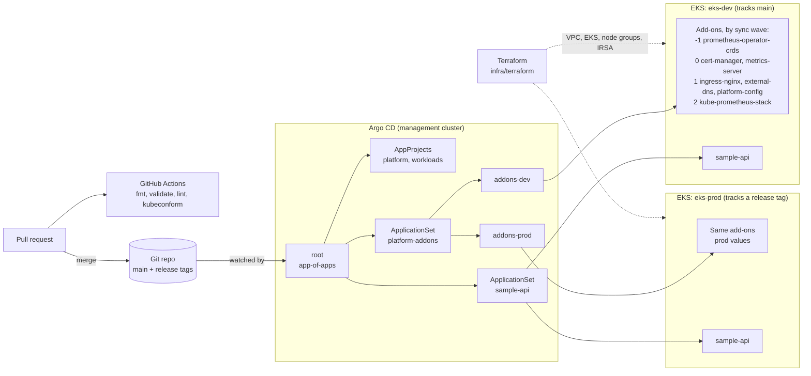
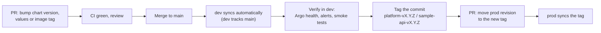

# eks-gitops-argocd

[](https://github.com/gopisaluja/eks-gitops-argocd/actions/workflows/ci.yml)

Amazon EKS provisioned with Terraform, with cluster add-ons and workloads delivered by Argo CD
using an **app-of-apps** root and **ApplicationSets** for per-environment fan-out (dev and prod).

This is a reference implementation of a common pattern, written to be read and adapted. It is
statically validated in CI (`terraform validate`, `helm lint`, `helm template`, `kubeconform`) but
it is not a drop-in production configuration: account IDs (`111122223333`, `444455556666`,
`777788889999`), domains (`example.com`) and the API endpoint CIDRs are placeholders.

## What it shows

- **Terraform**: VPC (public, private and intra subnets), EKS with managed node groups, EKS add-ons
  (`vpc-cni`, `coredns`, `kube-proxy`, `aws-ebs-csi-driver`, `eks-pod-identity-agent`), access
  entries instead of `aws-auth`, IRSA roles scoped to single service accounts, and a consistent
  tag set (`env`, `team`, `cost-center`, `managed-by`).
- **GitOps**: one hand-applied root Application. Everything else, including the AppProjects, the
  ApplicationSets and every add-on, is reconciled from Git with automated sync, prune and self-heal.
- **Ordering**: sync waves that actually gate on health: CRDs, then cert-manager, then the things
  that need its webhook, then monitoring.
- **Promotion**: dev follows `main`, prod follows an immutable Git tag. Promoting to prod is a
  one-line PR.
- **Workload chart**: a small Helm chart with probes, resource requests, a restricted
  securityContext, HPA, PDB, topology spread, optional Ingress and an IRSA-annotated ServiceAccount.

## Architecture



Argo CD runs once in a management cluster and deploys to `eks-dev` and `eks-prod`, which are
registered as named clusters. Argo CD authenticates to them with IAM: its pods use IRSA to assume a
deployer role, and that role has an EKS access entry on each cluster. No cluster tokens are stored
in Git or in Argo CD. To run one Argo CD per cluster instead, point each list element at
`in-cluster`.

## Repository layout

```text
.
├── .github/workflows/ci.yml          # terraform fmt/validate, helm lint/template, kubeconform
├── infra/terraform/                  # one state per environment (dev, prod, mgmt)
│   ├── versions.tf  providers.tf  main.tf
│   ├── vpc.tf                        # terraform-aws-modules/vpc 5.21.0
│   ├── eks.tf                        # terraform-aws-modules/eks 20.37.2, node groups, add-ons
│   ├── irsa.tf                       # IRSA roles: ebs-csi, external-dns, cert-manager, sample-api
│   ├── variables.tf  outputs.tf
│   └── terraform.tfvars.example
├── gitops/
│   ├── bootstrap/                    # applied by hand, once
│   │   ├── argocd-values.yaml        # values for the argo/argo-cd chart
│   │   ├── root-app.yaml             # the root app-of-apps Application
│   │   └── cluster-secret.example.yaml
│   ├── apps/                         # synced by root
│   │   ├── projects.yaml             # AppProjects: platform, workloads
│   │   ├── platform-addons.yaml      # ApplicationSet -> addons-dev, addons-prod
│   │   └── sample-api.yaml           # ApplicationSet -> sample-api-dev, sample-api-prod
│   ├── addons/                       # app-of-apps chart: one Application per add-on
│   │   ├── values.yaml               # catalogue: chart, pinned version, sync wave, base values
│   │   ├── values-dev.yaml           # dev overlay (IRSA ARNs, replicas, retention)
│   │   ├── values-prod.yaml          # prod overlay
│   │   └── templates/addons.yaml
│   └── platform-config/              # gp3 StorageClass, Let's Encrypt ClusterIssuers
└── charts/sample-api/                # Helm chart for the sample service
    ├── values.yaml                   # base values, used as-is for dev
    ├── values-prod.yaml              # prod overlay
    └── templates/                    # Deployment, Service, HPA, PDB, ServiceAccount, Ingress
```

### Pinned versions

| Component | Version |
| --- | --- |
| `terraform-aws-modules/vpc/aws` | 5.21.0 |
| `terraform-aws-modules/eks/aws` | 20.37.2 |
| `terraform-aws-modules/iam/aws` (IRSA submodule) | 5.60.0 |
| `hashicorp/aws` provider | `~> 5.95` |
| EKS Kubernetes version (default) | 1.35 |
| `argo/argo-cd` chart | 10.9.6 (Argo CD v3.5.3) |
| `prometheus-operator-crds` | 32.0.1 |
| `cert-manager` | v1.21.2 |
| `metrics-server` | 3.14.0 |
| `ingress-nginx` | 4.15.1 |
| `external-dns` | 1.22.0 |
| `kube-prometheus-stack` | 91.9.0 |

Versions change only through PRs. Add-on versions live in one place,
[`gitops/addons/values.yaml`](gitops/addons/values.yaml), so a bump is a single reviewed diff
that reaches dev first.

## Bootstrap

Prerequisites: Terraform >= 1.10, AWS CLI, kubectl, Helm 3, an S3 bucket for state, and a Route 53
hosted zone.

**1. Provision each cluster** (repeat with `environment = "prod"` and `"mgmt"` and a separate state key):

```bash
cd infra/terraform
cp terraform.tfvars.example dev.tfvars        # edit: cost_center, CIDRs, zone ARNs, admin roles
terraform init \
  -backend-config="bucket=<state-bucket>" \
  -backend-config="key=eks/dev/terraform.tfstate" \
  -backend-config="region=us-east-1" \
  -backend-config="use_lockfile=true"
terraform apply -var-file=dev.tfvars
terraform output irsa_role_arns
```

**2. Wire IRSA ARNs into Git.** Copy the role ARNs into `gitops/addons/values-<env>.yaml`
(cert-manager, external-dns) and `charts/sample-api/values*.yaml` (`serviceAccount.irsaRoleArn`).

**3. Install Argo CD on the management cluster:**

```bash
helm repo add argo https://argoproj.github.io/argo-helm
helm upgrade --install argocd argo/argo-cd --version 10.9.6 \
  --namespace argocd --create-namespace \
  -f gitops/bootstrap/argocd-values.yaml
```

**4. Register the workload clusters** using a filled-in copy of
[`cluster-secret.example.yaml`](gitops/bootstrap/cluster-secret.example.yaml) per cluster (names
`eks-dev` and `eks-prod`). Then give the deployer role an access entry through
`cluster_admin_role_arns`.

**5. Create the initial prod tags** that the prod list elements point to:

```bash
git tag platform-v1.0.0 && git tag sample-api-v1.0.0 && git push origin --tags
```

**6. Hand over to GitOps:**

```bash
kubectl apply -n argocd -f gitops/bootstrap/root-app.yaml
kubectl -n argocd port-forward svc/argocd-server 8080:80   # UI until the ingress is enabled
```

The root app creates the AppProjects (wave -2) and then the ApplicationSets. The ApplicationSets
generate `addons-dev` and `addons-prod`, and each of those rolls out its add-ons wave by wave.

**7. Out-of-band secret:** create `grafana-admin` in `monitoring` (see *Secrets* below), or
Grafana will wait for it.

## Promotion flow: dev to prod



- **Platform changes** (add-on versions or values) go through `gitops/addons/`. Prod reads the
  whole add-on catalogue at the tag set in
  [`gitops/apps/platform-addons.yaml`](gitops/apps/platform-addons.yaml), so prod never sees an
  untested combination of versions.
- **Application changes** follow the same path, with a separate tag stream (`sample-api-v*`).
  `values-prod.yaml` also pins the image tag explicitly.
- **Rollback** reverts the revision PR, which puts prod back on the previous tag. Tags are
  immutable, so "what is running in prod" is always one commit SHA.
- A prod change is a one-line diff in `gitops/apps/`, reviewed like any other change, and it
  leaves an audit trail in Git history.

Tools such as Argo CD Image Updater or Kargo can automate the tag-moving step. This repo keeps it as
an explicit PR so the flow is easy to follow.

## Design decisions and trade-offs

### App-of-apps vs ApplicationSet: both, for different jobs

- **App-of-apps** gives a single, hand-applied entry point (`root`) that manages Argo CD's own
  objects (AppProjects, ApplicationSets) from Git. Inside each environment, `addons-<env>` is
  another app-of-apps, rendered from a small Helm chart. This is where sync waves can order child
  Applications by health.
- **ApplicationSet** handles fan-out: one template, one element per environment. A **list
  generator** is used because two environments are easier to review as explicit elements, and
  each element carries its own Git revision, which is the promotion mechanism. At larger fleet
  sizes a **cluster generator** (select clusters by label `env=...`) avoids editing the list for
  every new cluster. A **git-directory generator** suits teams where every app or environment is a
  folder.
- Cost: there is one more layer to follow when debugging (root, then ApplicationSet, then
  `addons-<env>`, then the add-on). Per-environment differences have to fit the `values-<env>.yaml`
  overlay model rather than arbitrary per-env manifests.

### Sync waves and ordering

| Wave | What | Why it goes here |
| --- | --- | --- |
| -2 | AppProjects | Applications cannot reference a project that does not exist yet |
| -1 | prometheus-operator-crds, `platform-addons` ApplicationSet | ServiceMonitor/PrometheusRule CRDs are needed by every later chart that enables metrics |
| 0 | cert-manager, metrics-server | No dependencies; cert-manager's webhook must be up before any Certificate or Issuer |
| 1 | ingress-nginx, external-dns, platform-config | ClusterIssuers need the cert-manager webhook; the gp3 StorageClass is needed by Prometheus |
| 2 | kube-prometheus-stack | Heaviest, and depends on the CRDs and the gp3 StorageClass |
| 10 | `sample-api` ApplicationSet | Workloads last |

- Argo CD does not assess the health of child `Application` resources by default, so without
  extra configuration a wave only waits for the child Application to be *created*. The Lua health
  check in [`argocd-values.yaml`](gitops/bootstrap/argocd-values.yaml) restores health assessment,
  so wave N+1 starts only once wave N reports Healthy.
- Waves only order resources inside one parent Application. Applications generated by an
  ApplicationSet controller are not gated by the root app's waves. `sample-api` may therefore
  start before ingress-nginx is ready; it converges through retries. If strict ordering across
  ApplicationSets is needed, look at ApplicationSet progressive syncs.
- CRD-heavy charts use `ServerSideApply=true`, because the CRDs exceed the client-side
  last-applied annotation limit. kube-prometheus-stack runs with `crds.enabled: false`, so CRD
  upgrades are a separate, explicit step.

### IRSA rather than the node role

- With node-role permissions, every pod on a node gets the union of permissions needed by
  everything that might run there. IRSA scopes credentials to one `namespace:serviceaccount` pair:
  external-dns can change only the listed hosted zones, and sample-api can read only
  `/<cluster>/sample-api/*` in SSM.
- **EKS Pod Identity** is enabled too (the `eks-pod-identity-agent` add-on). It removes the
  per-cluster OIDC trust from role policies and makes roles reusable across clusters. IRSA is used
  for the add-ons here because every Helm chart exposes ServiceAccount annotations uniformly, and
  the same mechanism works for the cross-account Argo CD hub. New workloads can use either.
- Hardening left as an option: setting the node IMDS hop limit to 1 stops pods from falling back
  to the node role. Check that every add-on in use can live without IMDS before enforcing it.

### Managed node groups rather than Karpenter

- Managed node groups have few moving parts. AWS handles AMI updates and drains nodes gracefully
  during upgrades, and there is no extra controller to operate. There are two groups: `system`
  (on-demand, for controllers) and `apps` (SPOT by default for dev, on-demand recommended for
  prod).
- Karpenter gives better bin-packing, wider instance and Spot diversification, faster scale-up,
  and consolidation. In exchange it adds a controller, an interruption queue and NodePool/EC2NodeClass
  design. A common next step is to keep the `system` managed group (Karpenter has to run
  somewhere) and move `apps` to Karpenter.
- Node group `min_size`/`max_size` are only bounds. Nothing in this repo scales nodes: add
  cluster-autoscaler as another catalogue entry, or adopt Karpenter.

### Why automated sync with prune and selfHeal

- Git is the source of truth only if drift is corrected. `selfHeal` reverts manual `kubectl edit`s.
  `prune` removes resources whose manifests were deleted, so the cluster does not slowly collect
  orphans.
- Guardrails that make this safe:
  - Changes reach `main` only through PRs with CI.
  - AppProjects limit what each group of apps can deploy, and where.
  - The root Application has no cascade finalizer, and the platform ApplicationSet sets
    `preserveResourcesOnDeletion`, so deleting a parent object does not wipe an environment.
  - cert-manager CRDs are kept on uninstall.
  - `ignoreDifferences` covers fields that controllers legitimately mutate (webhook `caBundle`), so
    self-heal does not fight them.
- Break-glass: child Applications are owned by their parent, so turning off auto-sync on a child
  by hand is reverted by the parent's self-heal. Pause the parent first, or make the change in Git.

### Secrets

- Nothing secret is stored in this repo. Cluster registration uses IAM, the repo is public, so
  Argo CD needs no repo credentials, and IRSA removes static AWS keys.
- Application secrets: **External Secrets Operator** with AWS Secrets Manager or SSM Parameter
  Store (authenticated by IRSA) is the default choice on AWS. Rotation stays in AWS, access is
  logged in CloudTrail, and Git holds only `ExternalSecret` references. Example: the Grafana admin
  Secret referenced by `grafana.admin.existingSecret`.
- **SOPS** with a KMS key fits values that must be versioned and reviewed with the code (for
  example via KSOPS or the helm-secrets plugin in the repo-server). The cost is a custom
  repo-server setup and decryption keys that Argo CD can reach.
- Avoid Helm-generated random secrets under Argo CD. They change on every render and appear as
  permanent drift, which is why Grafana uses `existingSecret`.

### Other notes

- **ingress-nginx** is included because it is still widely deployed. However, the upstream project
  was retired in March 2026 and 4.15.1 is its last chart release. For a new build, evaluate a
  Gateway API implementation or the AWS Load Balancer Controller. The swap is contained: one
  catalogue entry plus `ingressClassName` in charts. The Service uses the legacy `nlb` annotation
  to keep the example dependency-free; the AWS Load Balancer Controller is the better fit for
  production NLBs.
- **Module versions**: the EKS module is pinned to the v20 line, with AWS provider v5. v21 requires
  provider v6 and renames inputs (for example `cluster_name` becomes `name`, `cluster_version`
  becomes `kubernetes_version`, `cluster_addons` becomes `addons`), so that upgrade should be its own
  change.
- **Hub and spoke vs Argo CD per cluster**: a hub gives one place to see and operate all
  environments, but the hub becomes a dependency for deployments, and its IAM role can reach every
  cluster. Argo CD per cluster isolates blast radius at the cost of N control planes to operate.
- **Not included on purpose**: cluster-autoscaler or Karpenter, the AWS Load Balancer Controller,
  External Secrets Operator, NetworkPolicies, a policy engine (Kyverno or Gatekeeper), and backups
  (Velero). Each would be another entry in `gitops/addons/values.yaml`.

## CI

[`.github/workflows/ci.yml`](.github/workflows/ci.yml) runs on every PR and on pushes to `main`:

| Job | Checks |
| --- | --- |
| `terraform` | `terraform fmt -check -recursive`, `terraform init -backend=false`, `terraform validate` |
| `manifests` | `helm lint --strict` (sample-api base and prod, addons chart per env); `helm template` of both charts per env and of the Argo CD bootstrap values against the pinned chart; `kubeconform -strict` on everything rendered plus the raw manifests, with CRD schemas from the Datree CRDs catalog |

To reproduce locally without installing Helm:

```bash
docker run --rm -v "$PWD/charts:/charts" alpine/helm:3.21.4 lint --strict /charts/sample-api
docker run --rm -v "$PWD/charts:/charts" alpine/helm:3.21.4 template sample-api /charts/sample-api \
  -f /charts/sample-api/values-prod.yaml
```

## License

[MIT](LICENSE)
